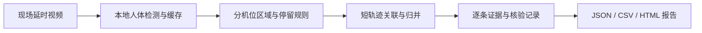

# TTC Campus｜校招视觉作品与 EventLens

**从校园活动的视觉设计与现场执行，到视频分析工具与可追溯的数据报告。**

这次校园活动以 TTC AIR 机场为视觉主题，制作了角色贴纸、三张 PPT 主视觉和现场机长立牌。下方直接展示作品；之后是用真实现场视频制作的 EventLens 分析案例。

## 01 / 校招视觉作品

### 机场主题贴纸

A5 机场贴纸最终打印版，包含航站楼、候机厅、机坪和登机场景。

### 三张 PPT 主视觉

**开场｜In the Age of AI, Where Should We Fly?**

**小组讨论｜Group Discussion**

**结尾｜You Don’t Need Every Answer to Take Off.**

### 现场机长立牌

用于校园活动现场的奶龙机长立牌，高 160 cm。下方为打印文件预览，登机牌上保留活动信息与二维码。

以上图片可点击查看大图。可编辑文件、高清打印文件与 PPT 均收录在[校招素材下载包](https://github.com/Hziibepacient/ttc-campus-materials/releases/tag/materials-2026-11-11)中。

[项目源码](eventlens-project/) · [下载完整版视频](https://github.com/Hziibepacient/ttc-campus-materials/releases/download/eventlens-showcase-2026-11-11/eventlens-campus-4x.mp4) · [案例与统计口径](showcase/README.md) · [软件与分析报告下载](https://github.com/Hziibepacient/ttc-campus-materials/releases/tag/eventlens-showcase-2026-11-11) · [校招素材下载](https://github.com/Hziibepacient/ttc-campus-materials/releases/tag/materials-2026-11-11)

## 02 / EventLens：把现场观察做成工具

https://github.com/user-attachments/assets/6249d915-7036-4ffd-b00b-869955689bb0

展开循环动态快览

**上方可直接播放约 75 秒、约 7 MB 的展示视频；另有完整版下载和可展开的循环快览。** 原片已是每 2 秒一帧的延时摄影，展示版再加速 4 倍。画面叠加实际检测框、分机位统计区域、相对现场时间与按记录起始时间累计的估算人次。

EventLens 将 YOLOX-S 本地人体检测、检测缓存、停留规则、证据复核和报告导出串成一条工作流。区域或停留门槛改变时，计数可复用已有检测缓存；每条停留记录保留原始帧号及证据，便于回看和修正。

[浏览 EventLens 0.2.0 源码与安装说明 →](eventlens-project/README.md)

## 03 / 校招现场：用真实素材验证流程

| 项目 | 本案例记录 |
|---|---:|
| 输入 | 2 段视频、8,300 个原始帧 |
| 采样覆盖 | 4 小时 36 分 40 秒 |
| 排除黑屏与不可观察移动 | 54 秒 |
| 可统计覆盖 | 4 小时 35 分 46 秒 |
| 附近停留人次 | **机器估算 1,093，未经逐条人工核验** |

这里统计的是**立牌附近停留人次**，不是全天不重复人数、活动到场人数、扫码数或由活动带来的增量客流。最短稳定停留设为 4 秒且至少 3 个采样点；人次误差与识别准确率尚未测量。

[查看完整案例、规则敏感性与数据 →](showcase/README.md)

## 04 / 校招活动：策划、视觉与现场物料

除 EventLens 外，本项目还保存了校园活动从策划、宣传、现场展示到配套网页的制作材料，共 **1,314 个文件**，包含源文件、输出成品、参考资料与历史版本。

以下路径是**素材压缩包解压后的目录**；大体积素材通过 Release 下载，没有全部展开存放在代码目录中。

| 内容 | 收录材料 | 解压后的位置 |
|---|---|---|
| 活动策划与宣传文案 | 校园 AI 求职与简历诊断活动方案、推送文案、视觉制作简报、校招设计参考 | `活动方案与补充源素材/`、`活动设计参考/` |
| 校招推文 | 9 张原始宣传图、文章 HTML、提取文字与图片来源清单 | `活动设计参考/校招推文-*` 等文件 |
| 开场、结尾与现场投屏 | TTC AIR 云海机长开场、Ending、小组讨论和公司介绍视觉，保留多个制作版本 | `活动设计参考/TTC-AIR开场视觉/`、`TTC-AIR小组讨论视觉/`、`TTC公司介绍视觉/` |
| 登机手册与指南 | 登机指南、可编辑源文件、预览、设计调研与来源说明 | `活动设计参考/TTC-AIR登机手册/` |
| 贴纸与商家交付 | 角色贴纸、A5 机场贴纸排版、打印最终版、分层 SVG、角色图和商家素材 ZIP | `活动设计参考/TTC-AIR贴纸/`、`活动方案与补充源素材/` |
| 现场立牌 | 160 cm 立牌打印成品、相关设计文件及核验材料 | `活动设计参考/立牌打印160cm/` |
| 角色与品牌参考 | TTC 奶龙机长、迎宾地勤、品牌公开素材、角色素材库与参考图 | `活动设计参考/TTC奶龙机长/`、`TTC奶龙迎宾地勤/`、`TTC品牌公开素材/`、`奶龙素材库/` 等 |
| 演示与介绍资料 | TTC 校招 PPT、公司介绍 PDF、两个 AI 求职指南版本，以及另存的校招 PPT 视觉页和图片 | `演示与介绍/`、`校招PPT视觉页素材/` |
| 配套网页 | 校园活动预览页、TTC AIR 机场互动网站、v1 历史项目，以及多个版本的上传包、源文件、角色介绍和表情领取页 | `配套网页/` |

网页素材包含 HTML、CSS、JavaScript 和图片等静态文件；各项目的 README 说明入口及使用方式。历史版本、参考资料和过程稿保留用于追溯，不代表全部为已批准定稿。

### 下载校招素材

| 文件 | 大小 | 内容 |
|---|---:|---|
| [主素材包 ZIP](https://github.com/Hziibepacient/ttc-campus-materials/releases/download/materials-2026-11-11/TTC-Campus-Materials-20261111.zip) | 约 1.11 GiB | 视觉、手册、贴纸、立牌、演示资料、配套网页及制作参考 |
| [补充包 ZIP](https://github.com/Hziibepacient/ttc-campus-materials/releases/download/materials-2026-11-11/TTC-Campus-Supplement-20261111.zip) | 约 44 MiB | 活动方案、推送文案和下载目录中的商家分层源素材包 |
| [下载校验文件](SHA256SUMS.txt) | — | 两个素材包的 SHA256 |

两个 ZIP 可以分别解压。[文件清单 CSV](manifest.csv) / [JSON](manifest.json) 列出全部 1,314 个文件的相对路径、字节数和 SHA256；[排除清单](excluded.json) 记录未纳入的软件工具、依赖与外部技能源码。[原素材归档说明](docs/materials-archive.md) 保留初次上传时的范围说明。

## 05 / EventLens：代码、视频与报告导航

| 内容 | 在线查看 | 下载与用途 |
|---|---|---|
| 0.2.0 项目源码 | [源码目录](eventlens-project/) · [安装与使用说明](eventlens-project/README.md) | [0.2.0 源码 ZIP](https://github.com/Hziibepacient/ttc-campus-materials/releases/download/eventlens-showcase-2026-11-11/EventLens-0.2.0-Source.zip)；含命令行、人体检测、计数、复核、评估和报告模块 |
| AI 助手技能与源码来源 | [EventLens 技能](eventlens-project/src/eventlens/skill/eventlens/SKILL.md) · [来源校验记录](eventlens-project/provenance.json) | 技能说明如何通过助手操作工具；来源记录说明代码与原始 wheel 的对应关系 |
| 原始 0.2.0 安装包 | [原分发安装说明](eventlens-project/distribution/README-zh.md) | [Python wheel](https://github.com/Hziibepacient/ttc-campus-materials/releases/download/eventlens-showcase-2026-11-11/eventlens-0.2.0-py3-none-any.whl)；安装依赖与系统要求见说明 |
| 历史 0.1.0 项目 | 与当前版本单独归档 | [历史源码 ZIP](https://github.com/Hziibepacient/ttc-campus-materials/releases/download/eventlens-showcase-2026-11-11/EventLens-0.1.0-Historical-Source.zip)；保留早期源码、测试、文档和本地界面原型 |
| 75 秒展示视频 | 本页原生播放器 · [案例页](showcase/README.md) · [封面](showcase/assets/eventlens-poster.png) · [GIF 快览](showcase/assets/eventlens-preview.gif) | [约 7 MB 网页播放版](https://github.com/Hziibepacient/ttc-campus-materials/releases/download/eventlens-showcase-2026-11-11/eventlens-campus-web.mp4) · [约 46 MiB 高清完整版](https://github.com/Hziibepacient/ttc-campus-materials/releases/download/eventlens-showcase-2026-11-11/eventlens-campus-4x.mp4) |
| 分析明细与人流趋势 | [停留记录 CSV](showcase/data/visits.csv) · [十分钟窗口 CSV](showcase/data/time_bins.csv) · [完整 JSON](showcase/data/report.json) · [趋势图](showcase/assets/traffic-trend.png) | 用于检查每条记录、时间分布、机位统计和规则敏感性 |
| 完整 HTML 分析报告 | [案例解释与统计口径](showcase/README.md) | [完整报告 ZIP](https://github.com/Hziibepacient/ttc-campus-materials/releases/download/eventlens-showcase-2026-11-11/EventLens-Campus-Analysis-Report.zip)；含 HTML、1,093 张证据图和 CSV / JSON，解压后打开 `report.html` |
| 配置与验证记录 | [相对路径配置示例](showcase/data/eventlens.example.json) · [原分析完整性核验](showcase/data/verification.json) · [本次视频核验](showcase/data/showcase-verification.json) | [EventLens 下载校验文件](https://github.com/Hziibepacient/ttc-campus-materials/releases/download/eventlens-showcase-2026-11-11/EventLens-SHA256SUMS.txt)；核对文件完整性与执行范围 |

源码浏览、软件安装、分析结果和视频展示分别提供入口。原始大视频及模型权重未随项目发布；本次展示复用已有检测缓存并重新核对计数，没有新增人工确认。历史 0.1.0 的测试不代表 0.2.0 经过相同测试，构建与完整性检查也不代表人次统计准确率。

本仓库当前为私有。工具代码沿用 Apache-2.0；人物影像、第三方角色和参考素材的权利不随代码许可证转授。EventLens 为 Alpha 原型，版本来源及已知工程限制见项目说明。
