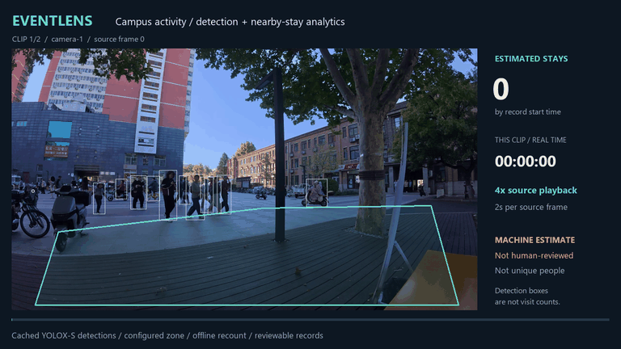
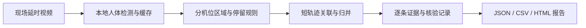
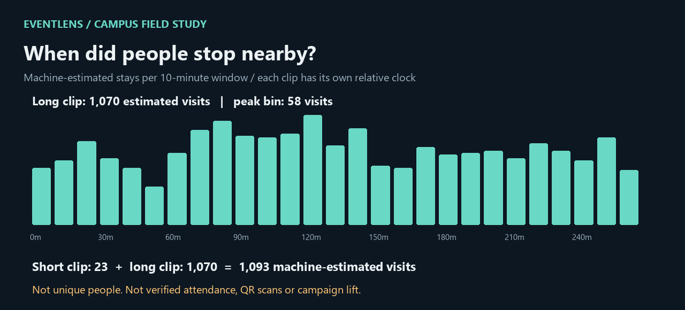

# TTC Campus × EventLens

**从校园活动的视觉设计与现场执行，到视频分析工具与可追溯的数据报告。**

这个作品集收录 TTC 校招活动素材，并用真实现场延时摄影展示 EventLens：如何把“立牌周围有多少人停下”转成可配置、可复核的分析流程。

[项目源码](eventlens-project/) · [完整加速视频](showcase/assets/eventlens-campus-4x.mp4) · [案例与统计口径](showcase/README.md) · [软件与分析报告下载](https://github.com/Hziibepacient/ttc-campus-materials/releases/tag/eventlens-showcase-2026-11-11) · [校招素材下载](https://github.com/Hziibepacient/ttc-campus-materials/releases/tag/materials-2026-11-11)

## 01 / EventLens：把现场观察做成工具

**上方是循环快览；点击查看约 75 秒的 H.264 完整展示视频。** 原片已是每 2 秒一帧的延时摄影，展示版再加速 4 倍。画面叠加实际检测框、分机位统计区域、相对现场时间与按记录起始时间累计的估算人次。

EventLens 将 YOLOX-S 本地人体检测、检测缓存、停留规则、证据复核和报告导出串成一条工作流。区域或停留门槛改变时，计数可复用已有检测缓存；每条停留记录保留原始帧号及证据，便于回看和修正。

[浏览 EventLens 0.2.0 源码与安装说明 →](eventlens-project/README.md)

## 02 / 校招现场：用真实素材验证流程

| 项目 | 本案例记录 |
|---|---:|
| 输入 | 2 段视频、8,300 个原始帧 |
| 采样覆盖 | 4 小时 36 分 40 秒 |
| 排除黑屏与不可观察移动 | 54 秒 |
| 可统计覆盖 | 4 小时 35 分 46 秒 |
| 附近停留人次 | **机器估算 1,093，未经逐条人工核验** |

这里统计的是**立牌附近停留人次**，不是全天不重复人数、活动到场人数、扫码数或由活动带来的增量客流。最短稳定停留设为 4 秒且至少 3 个采样点；人次误差与识别准确率尚未测量。

[查看完整案例、规则敏感性与数据 →](showcase/README.md)

## 校招活动设计素材

活动视觉、推文、手册、角色贴纸、立牌、校招 PPT、AI 求职指南和配套网页，共 1,314 个文件，保留源文件与历史版本。

[打包下载](https://github.com/Hziibepacient/ttc-campus-materials/releases/tag/materials-2026-11-11) · [文件清单](manifest.csv) · [原素材归档说明](docs/materials-archive.md)

本仓库当前为私有。工具代码沿用 Apache-2.0；人物影像、第三方角色和参考素材的权利不随代码许可证转授。EventLens 为 Alpha 原型，版本来源及已知工程限制见项目说明。
