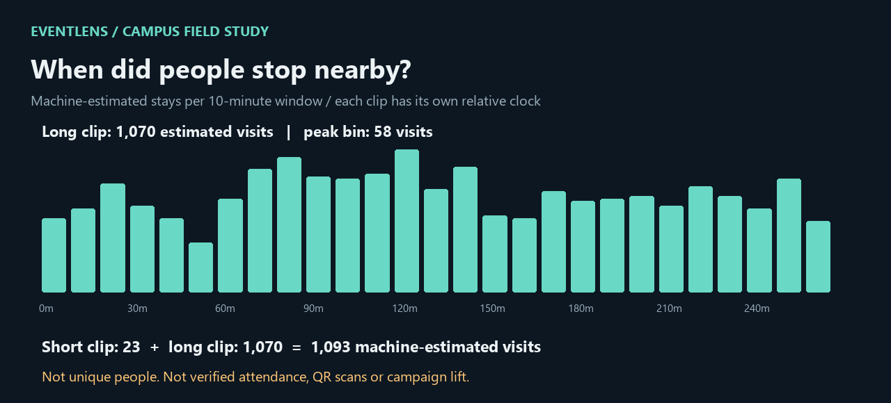

# EventLens / 校招现场分析案例

[返回作品集首页](../README.md) · [查看源码](../eventlens-project/) · [下载完整版视频](https://github.com/Hziibepacient/ttc-campus-materials/releases/download/eventlens-showcase-2026-11-11/eventlens-campus-4x.mp4) · [下载软件、源码与完整分析报告](https://github.com/Hziibepacient/ttc-campus-materials/releases/tag/eventlens-showcase-2026-11-11)

https://github.com/user-attachments/assets/6249d915-7036-4ffd-b00b-869955689bb0

[下载高画质完整版](https://github.com/Hziibepacient/ttc-campus-materials/releases/download/eventlens-showcase-2026-11-11/eventlens-campus-4x.mp4) · [查看视频封面](assets/eventlens-poster.png)

## 问题与做法

校园广场上放置活动立牌，用固定机位延时摄影观察附近停留情况。问题是如何从长时间素材中整理出可回看的停留记录，而不是把每个检测框或轨迹 ID 当成人次。

本案例复用 2026-10-20 的 EventLens 0.2.0 本地分析结果。原始两片为 1920×1080 HEVC，每 2 秒拍摄一帧；两段录制间的空档不补算。历史推理使用 YOLOX-S、ONNX Runtime CPU、OpenCV 解码适配器。

本次展示重新运行计数引擎，1,093 条记录的键与原报告完全一致；视频渲染读取全部 8,300 个原始帧，每 4 帧选一帧输出，保留黑屏和移动过程并标注排除状态。视频里的累计数是完整缓存离线重算后按记录起始时间回放，不是实时在线计数或推理速度演示。

## 结果与口径

| 指标 | 数值与含义 |
|---|---|
| 短片 | 301 帧，机器估算 23 人次 |
| 长片 | 7,999 帧，机器估算 1,070 人次 |
| 合计 | **机器估算 1,093 停留人次，未经逐条人工核验** |
| 采样覆盖 | 帧数 × 2 秒 = 4 小时 36 分 40 秒 |
| 可统计覆盖 | 扣除黑屏 24 秒和不可观察移动 30 秒后，4 小时 35 分 46 秒 |
| 最短停留 | 稳定采样点至少 3 个，首末至少相隔 4 秒 |
| 归并 | 最大间隔 30 秒，另有位置和外观约束；不跨黑屏或机位可靠匹配身份 |
| 核验状态 | 0 条人工确认，1,093 条待核验；准确率与人次误差未测量 |

附近停留计入，吃东西、看手机、聊天不排除；本轮不统计合照。机器记录可能包含慢行或骑车误计、遮挡造成的拆分、误合并和漏计，不能将结果直接用于声称准确到场人数。

## 人流趋势与规则敏感性

图中只绘制长片每 10 分钟窗口的机器估算停留记录数，以记录起始时刻归桶。短片另计 23 人次；两段各自使用相对时间，没有伪造绝对时钟或把录制间空档拼成连续活动时间。

| 最短稳定停留 | 完整重算后的机器估算人次 |
|---|---:|
| 4 秒 | 1,093 |
| 6 秒 | 938 |
| 10 秒 | 647 |
| 20 秒 | 340 |
| 60 秒 | 42 |

这些差异说明结果对规则的依赖，不是误差范围或置信区间。所有数值来自保存的历史报告。

## 可检查的交付

- [EventLens 0.2.0 源码](../eventlens-project/)：从已有 wheel 提取，附来源校验与可构建的包配置。
- [停留明细 CSV](data/visits.csv)、[时间窗口 CSV](data/time_bins.csv)、[完整结构化报告](data/report.json)。
- [可移植配置示例](data/eventlens.example.json)：视频与模型使用相对路径，不附原始大视频和模型权重。
- [原分析完整性核验](data/verification.json)、[本次视频制作核验](data/showcase-verification.json)。
- [Release 下载](https://github.com/Hziibepacient/ttc-campus-materials/releases/tag/eventlens-showcase-2026-11-11)：原始 0.2.0 wheel、0.2.0 源码包、历史 0.1.0 源码包、含 1,093 张证据图的完整 HTML 报告包、展示视频。

当前统计体现工具工作流与可追溯性，未完成独立人工真值评估。后续应在不同机位、拥挤程度和光照条件下标注校准与留出片段，再报告误计、漏计、重复及错误合并。
